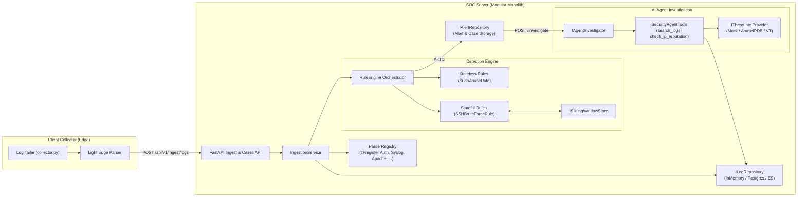

# Agentic SOC Platform (MVP)

Production-ready, highly extensible Python skeleton and data contracts for an **Agentic SOC (Security Operations Center) Platform**.

Built on **Clean Architecture (Domain-Driven Design)** principles, decoupling telemetry ingestion, log parsing, correlation rules, incident storage, and autonomous AI agent investigations.

---

## 🏛 Architecture Overview



---

## 📁 Project Structure

```text
qt-agentic-soc/
├── client/
│   ├── config.yaml                    # Edge collector configuration
│   ├── collector.py                   # File tailer with byte offset tracking & batch flusher
│   └── parsers.py                     # Fast client-side light regex parser
├── server/
│   ├── main.py                        # FastAPI server entrypoint
│   └── src/
│       ├── common/
│       │   └── schemas.py             # Pydantic v2 Contracts (Hybrid ECS-style envelope)
│       ├── parsers/
│       │   ├── base.py                # BaseLogParser & Plugin ParserRegistry
│       │   └── auth_parser.py         # AuthLogParser (sshd, sudo, useradd, pam)
│       ├── engine/
│       │   ├── base.py                # BaseRule & RuleEngine orchestrator
│       │   ├── state_store.py         # ISlidingWindowStore (Event-time deque window)
│       │   └── rules/
│       │       ├── sudo_abuse.py      # Stateless sudo failure / not in sudoers rule
│       │       └── ssh_bruteforce.py  # Stateful 5-min sliding window SSH brute force rule
│       ├── repositories/
│       │   ├── base.py                # ILogRepository & IAlertRepository contracts
│       │   └── memory.py              # In-memory async implementations for dev & test
│       ├── agent/
│       │   ├── base.py                # IThreatIntelProvider & IAgentInvestigator
│       │   ├── tools.py               # search_logs & check_ip_reputation (@tool ready)
│       │   └── workflow.py            # Autonomous AI triage, TI enrichment & report generation
│       ├── services/
│       │   └── ingestion_service.py   # Core pipeline orchestrating ingestion, rules & cases
│       └── api/
│           ├── dependencies.py        # Dependency injection container
│           └── v1/
│               ├── ingest.py          # POST /api/v1/ingest/logs
│               └── cases.py           # GET /api/v1/cases, POST /api/v1/cases/{id}/investigate
├── tests/
│   ├── test_schemas.py                # Schema validation & serialization tests
│   ├── test_auth_parser.py            # Log parser unit tests
│   ├── test_rules.py                  # Stateful & stateless detection rule tests
│   └── test_integration.py            # End-to-end pipeline & API endpoint integration tests
├── .env.example                       # Environment variables template
├── .gitignore                         # Comprehensive Git ignore rules
├── pyproject.toml                     # Python project metadata & tool configurations
└── requirements.txt                   # Production & testing dependencies
```

---

## 🚀 Quickstart Guide

### 1. Requirements & Setup
- Python 3.10+
- Install dependencies:
```bash
pip install -r requirements.txt
```

### 2. Run the Automated Test Suite
To run all 21 unit and integration tests:
```bash
python -m pytest tests -v
```

### 3. Start the SOC Ingest & Case Server
```bash
python server/main.py
```
Or via Uvicorn directly:
```bash
uvicorn server.main:app --host 0.0.0.0 --port 8000 --reload
```
Interactive Swagger API documentation will be available at:
`http://127.0.0.1:8000/docs`

### 4. Run the Edge Collector Agent
Configure monitored files in `client/config.yaml`, then start:
```bash
python client/collector.py
```

---

## 🔌 Extensibility Guide

### 1. Adding a New Log Source (e.g., Apache Access Log)
1. Create a parser in `server/src/parsers/apache_parser.py`:
```python
from server.src.parsers.base import BaseLogParser, ParserRegistry
from server.src.common.schemas import LogType

@ParserRegistry.register
class ApacheLogParser(BaseLogParser):
    @property
    def supported_log_type(self) -> LogType:
        return LogType.APACHE

    def can_handle(self, log_type: str, source_path: str = "") -> bool:
        return log_type == LogType.APACHE.value or "access.log" in source_path

    def parse_line(self, raw_line: str) -> Optional[Dict[str, Any]]:
        # Regex or grok extraction
        return {"service": "apache", "http_status": 200, "src_ip": "1.2.3.4"}
```
*No modifications to pipeline or ingestion service needed!*

### 2. Adding a New Detection Rule
Create a rule inheriting from `BaseRule`:
```python
from server.src.engine.base import BaseRule
from server.src.common.schemas import Alert, LogEventEnvelope, Severity, LogType

class WebScanningRule(BaseRule):
    rule_id = "RULE-WEB-SCAN-001"
    rule_name = "Web Vulnerability Scan Detected"
    severity = Severity.MEDIUM
    supported_log_types = {LogType.APACHE}

    def evaluate(self, event: LogEventEnvelope) -> Optional[Alert]:
        if event.fields.get("http_status") == 404:
            # sliding window or pattern matching
            pass
        return None
```
Register the rule in `server/src/api/dependencies.py` container.

### 3. Swapping Persistence (e.g., PostgreSQL or Elasticsearch)
Implement `ILogRepository` and `IAlertRepository` in `server/src/repositories/postgres.py` and inject into `Container` in `dependencies.py`. All domain logic and rules remain 100% unchanged.

---

## 📡 API Reference Summary

| Method | Endpoint | Description |
|---|---|---|
| `GET` | `/health` | Service health status |
| `POST` | `/api/v1/ingest/logs` | Ingests a batch of telemetry envelopes, normalizes & detects |
| `GET` | `/api/v1/cases` | Lists open/investigating security cases |
| `GET` | `/api/v1/cases/{case_id}` | Gets full case details, correlated alerts & artifacts |
| `POST` | `/api/v1/cases/{case_id}/investigate` | Triggers autonomous AI SOC Analyst investigation |

